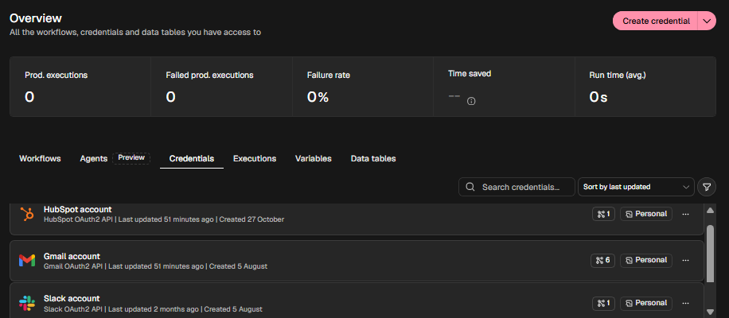
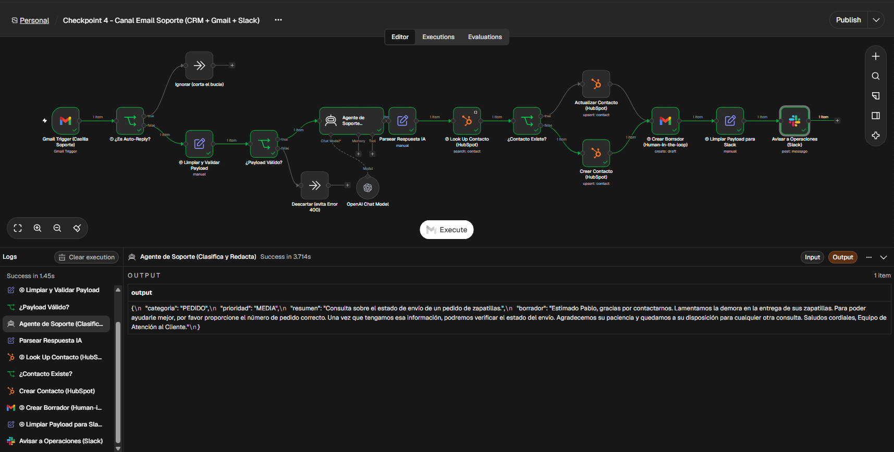
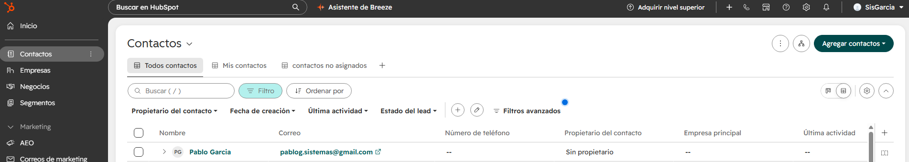
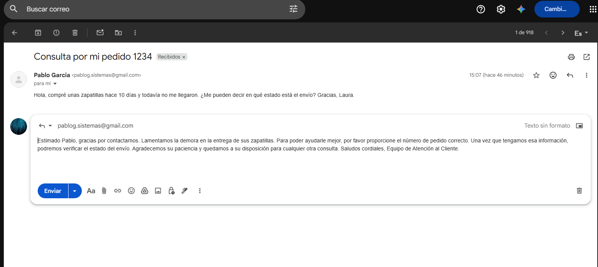
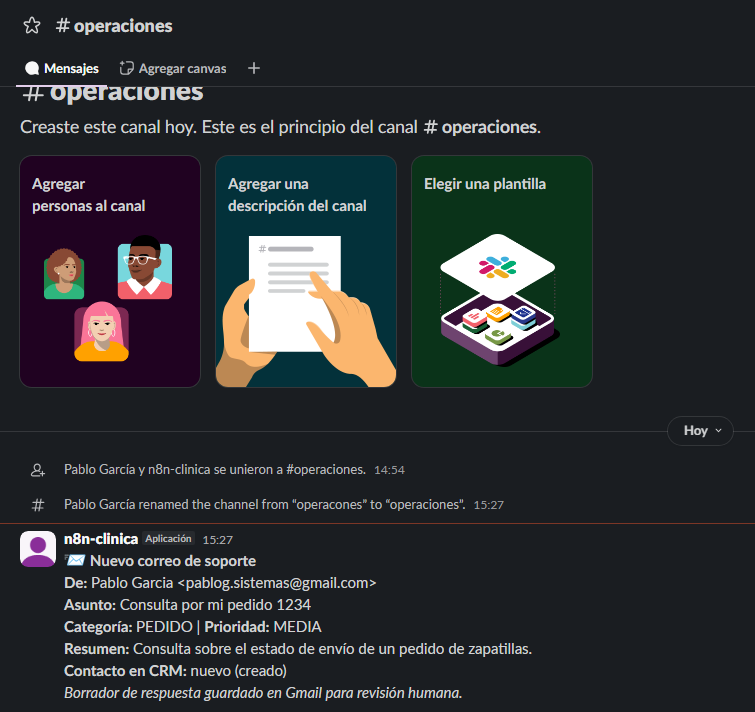

# Checkpoint 4 · Integraciones Avanzadas (CRM + Gmail + Slack)

**Alumno:** Pablo García · **Curso:** CoderHouse – Automation IA Avanzado

Este flujo es el **canal de correo de soporte** del mismo proyecto integrador que vengo construyendo desde el Módulo 1 (agente base → Manager-Worker → memoria por Session_ID). Ahora el sistema lee la casilla de soporte, registra al cliente en el CRM, deja una respuesta en borradores para que la apruebe una persona y avisa al equipo por Slack.

## Credenciales conectadas (OAuth2)



| Herramienta | Rol en el ecosistema | Operaciones usadas |
|---|---|---|
| **HubSpot** (CRM) | Fuente única de verdad de los clientes | Buscar contacto · Crear o actualizar contacto |
| **Gmail** | Casilla de soporte | Leer correos nuevos · Crear borrador |
| **Slack** | Canal del equipo de operaciones | Publicar mensaje en `#operaciones` |

## Arquitectura

```
[Gmail Trigger: correo entrante]
        │
        ▼
① [IF ¿Es auto-reply?] ── Sí ─▶ (Ignorar: corta el bucle infinito)
        │ No
        ▼
④ [Set: limpiar y validar payload] ─▶ [IF ¿Email válido?] ── No ─▶ (Descartar: evita Error 400)
        │ Sí
        ▼
[AI Agent: clasifica y redacta] ─▶ [Set: parsear respuesta IA]
        │
        ▼
② [HubSpot: Look up del contacto por email]
   ┌────┴─────┐
  Existe     No existe
   ▼            ▼
[Actualizar] [Crear contacto]     (el Look up evita el Error 409)
        │
        ▼
③ [Gmail: Create Draft]           (Human-in-the-loop: nada se envía sin aprobación)
        │
        ▼
④ [Set: payload mínimo para Slack] ─▶ [Slack: aviso a #operaciones]
```

## Los 4 controles preventivos

1. **IF anti auto-reply:** ignora correos cuyo asunto o remitente contenga *Auto-reply*, *Out of office*, *Fuera de la oficina*, *Undeliverable*, *no-reply@* o *mailer-daemon*. Así el sistema nunca le contesta a una respuesta automática.
2. **Look up antes del Create:** antes de tocar el CRM se busca el contacto por email. Si existe, se actualiza; si no, se crea. Evita duplicados y el Error 409.
3. **Create Draft (Human-in-the-loop):** la respuesta de la IA queda en borradores de Gmail, en el mismo hilo del cliente. Una persona la revisa y decide si la envía.
4. **Sets de limpieza de payload:** el primero deja solo remitente, asunto, cuerpo en texto (recortado a 3000 caracteres) e hilo, y valida que el email tenga formato correcto (evita el Error 400). El segundo arma un único texto corto para Slack, sin adjuntos ni HTML.

## Mínimo privilegio

- **HubSpot:** solo se leen y escriben los campos `email` y `firstname` de contactos.
- **Gmail:** solo se leen correos no leídos del INBOX y se crean borradores. El flujo **no envía** correos.
- **Slack:** solo publica mensajes en un canal; no lee historial ni gestiona usuarios.
- El agente de IA no tiene herramientas propias: no puede actuar sobre el CRM ni la casilla; solo devuelve un JSON que el flujo procesa con pasos deterministas.

## Prueba de funcionamiento

Correo de prueba enviado desde una cuenta secundaria (por eso el remitente figura como *Pablo Garcia*): *"Compré unas zapatillas hace 10 días y todavía no me llegaron..."*.

**1. Ejecución completa en n8n:** el agente lo clasificó como PEDIDO / prioridad MEDIA, el contacto no existía en el CRM y se tomó la rama de creación.



**2. Contacto creado en HubSpot** (el Look up previo evita duplicarlo si vuelve a escribir):



**3. Borrador de respuesta en Gmail**, dentro del mismo hilo y sin enviar (Human-in-the-loop):



**4. Aviso al equipo en Slack** (`#operaciones`), con el payload mínimo:



## Cómo importarlo

1. En n8n: **Create Workflow** → menú **...** → **Import from File** → `checkpoint4_pablo_garcia.json`.
2. Asignar las credenciales de OpenAI, Gmail, HubSpot y Slack en los nodos correspondientes.
3. Probar con **Execute Workflow** (el trigger toma el último correo no leído de la casilla).
